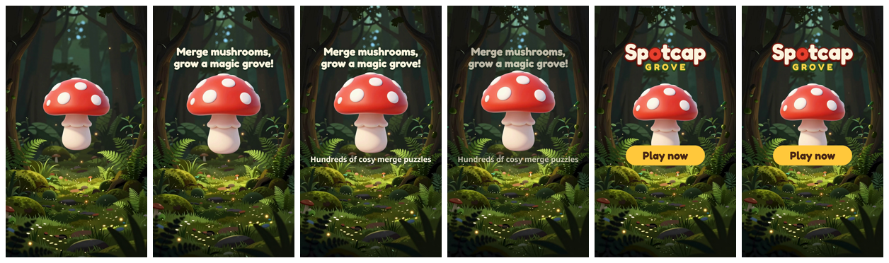

# artpipe

An agent-runnable art pipeline for live mobile games. Every step runs
headless and returns machine-readable JSON, so an AI agent can do the whole
loop with no human in it: generate an asset, validate it, fix what is safe
to fix, and import it into Unity.

> **Status: Phases 1 to 5 complete.** A headless Maya validator with safe
> auto-fixes, deterministic FBX export, and a Unity 6 import pipeline with an
> import gate, per-class import rules, GPU budgets and a batchmode CLI (one
> command takes a messy Maya scene to a clean Unity prefab). An AI generation
> stage that goes from a prompt to a prefab with provenance (Phase 3). And UA
> video creatives at scale: one template, a kit per game, rendered, checked
> against four ad networks' specs and repaired (Phase 4). And an MCP server
> that lets an agent run all of it, with jobs, a persistent Maya worker, an
> approval queue for anything that touches the game, and review tools that
> show the agent's model what the checks can't judge (Phase 5). One-page
> overview: [docs/architecture.md](docs/architecture.md).

## What it does today

```powershell
.\artpipe.cmd build out\fixtures\SM_Messy.ma --class prop_small --texture T_Messy_D.png
# artpipe build: PASS out/build/SM_Messy/build.report.json -> Assets/Art/prop_small/SM_Messy.prefab
```

`SM_Messy` is a rushed export with six problems: default names, a foreign UV
set name, live history, an unfrozen and off-centre transform, a metre scene.
In about 20 seconds:

1. **Maya** (headless `mayapy`) runs 18 checks against the rules for its
   class, applies the 6 safe fixes, saves a fixed copy, and validates it again
   from scratch. Holes, n-gons and over-budget meshes are never "fixed":
   the build stops and the report says where they are.
2. It **exports a canonical FBX** with explicit, verified exporter settings.
   Same scene, same bytes: no timestamps, no absolute paths, stable object
   IDs. Then it validates that FBX too and writes its report next to it.
3. **Unity** (batchmode) gates the FBX: it needs a passing report that
   describes these exact bytes. It then imports it with the class's import
   settings, measures what the GPU really gets (vertices after seam splits,
   LOD vertex ratios, submeshes), imports the texture as real ASTC, and
   creates a Prefab Variant.
4. One **build report** links every stage by path and sha256. Every command
   returns `0` pass / `1` asset failed / `2` tool error.

### UA creatives (Phase 4)

```powershell
.\artpipe.cmd banners setup                                          # once: pinned ffmpeg + Chromium + Playwright
.\artpipe.cmd banners batch --template hero_endcard --games spotcap_grove
# artpipe banners: 1 banner(s): 1 passed, 0 handed over, 0 errors, 0 skipped, 0 reused, 1 repaired, 322 s.
```



*Spotcap Grove is a made-up game. The hero is a Phase 3 concept cut out with its
mask, the background one Z-Image image, the logo a wordmark set in an OFL font.*

1. One **template** (layers, keyframes, slots) and one **kit** per game
   (palette, fonts, art, strings), each kit asset with a licence record and
   a provenance sidecar. Kit checks run first.
2. **Headless Chromium, time stepped frame by frame** (no screen recording),
   then a pinned **x264** encode: byte-identical re-renders on this machine.
3. **17 banner checks** against the strictest of Meta, TikTok, Unity Ads and
   AppLovin (size, codec, constant frame rate, 6-60 s, 100 MB, the 516 kbps
   floor, safe zone) and house rules (text fit, font fallback, readable
   sizes, WCAG contrast on the real pixels behind the text, first frame,
   end card, logo).
4. **Repair**: shrink text (found with 3 s layout passes, not renders),
   recolour from the palette, or hand over with the reason. Here the headline
   wrapped to 3 lines; it was shrunk to x0.792 and passed on the second render.
5. **Batch**: every game x placement x locale, reused when nothing changed
   (an input hash over the files, the rules, the tools and the code: 322 s
   rendered, 2 s reused), a summary, a contact sheet, and a warning when two
   games look alike.

Details and every probed behaviour: [docs/banners.md](docs/banners.md).

### The agent layer (Phase 5)

```powershell
.\artpipe.cmd agent setup        # once: Python 3.12 venv with the hash-locked MCP SDK
# open the repo in Claude Code: .mcp.json registers `artpipe agent serve`; /mcp lists 29 tools
.\artpipe.cmd queue list          # what the agent asked to do, and what it handed over
.\artpipe.cmd queue approve approval-1a2b3c4d5e --note "ok"   # at a console: you type the id back
```

1. **artpipe is an MCP server; the client is the agent.** Each tool runs an
   artpipe command and returns its exit code, meaning and files. The
   pipeline never calls an LLM.
2. **Two levels of tools**: fine (list checks, run one check, apply one fix,
   in a persistent Maya worker: 0.04-0.12 s instead of a 4.6 s cold start)
   and coarse (validate, generate stages, banners, `unity verify`).
3. **Jobs** for long work, with live ComfyUI progress, a GPU queue (first
   come first served) and a shared ComfyUI server.
4. **An approval queue**: anything that writes outside `out/` (a Unity
   import, kit art, goldens) is a request a human approves once, for that
   exact command. Failed jobs land there as hand-overs with their reason.
5. **Judgement tools** return images (concept and mask, banner contact
   sheet) with the questions no check answers; the agent records a verdict
   and may reword a concept at most twice.

Guide and example sessions: [docs/agent.md](docs/agent.md); tool reference
(generated): [docs/agent_tools.md](docs/agent_tools.md).

## The rules

All rules live in [`conventions/`](conventions/), not in code. C# reads them
from a generated, hash-checked `conventions.lock.json`, and never holds a
budget number.

| File | Holds |
|---|---|
| [`mesh_budgets.yaml`](conventions/mesh_budgets.yaml) | 8 asset classes for low/mid Android: triangle and GPU-vertex budgets, LODs, materials, size, pivot, UVs, severity overrides |
| [`naming.schema.json`](conventions/naming.schema.json) | the naming grammar `<SM\|SK>_<AssetName>[_Variant][_LODn]`, with valid and invalid examples that Python and C# tests both enforce |
| [`texture_rules.yaml`](conventions/texture_rules.yaml) | map types (`_D _N _MS _AO _E`): color space, alpha rules, ASTC block per platform, max size per class |
| [`fbx_export.yaml`](conventions/fbx_export.yaml) | every FBX exporter setting, versioned |
| [`unity_import.yaml`](conventions/unity_import.yaml) | managed folder, shared materials, LOD switch heights, ModelImporter settings per class |
| [`generation.yaml`](conventions/generation.yaml), [`gen_styles.yaml`](conventions/gen_styles.yaml) | the pinned ComfyUI and models (sha256, licence), concept and model checks, the repair policy, the art styles |
| [`banners.yaml`](conventions/banners.yaml) | the UA placements (every number cited to a network's spec page), the pinned renderer tools, the encoder, allowed licences, the house rules of the banner checks, the repair policy |
| `*.schema.json` | the report contracts: Maya, Unity, build, generation and banner reports and records |

* **[docs/conventions.md](docs/conventions.md)** explains every Maya-side
  rule and why it exists.
* **[docs/unity_import.md](docs/unity_import.md)** covers the Unity side:
  folder layout, gate, import settings, GPU budgets, textures, every check id,
  and the Unity behaviours the design relies on.

Tables in both docs are generated from these files, and tests fail if the docs drift.

## Quick start

Requirements: Windows, Maya 2023+ (`mayapy`, Python 3.9), Unity 6000.5 with
Android Build Support; for generation, Comfy Desktop (the pipeline runs its
own pinned server); for banners, Node.js 20+ (`banners setup` fetches the
rest). The code stays Python 3.9-compatible.

```powershell
.\artpipe.cmd py -m pip install --user -r requirements-maya.txt   # once: pyyaml, pytest, jsonschema
.\artpipe.cmd unity setup                                           # once: URP, Linear, text assets
.\artpipe.cmd fixtures                                              # build 45 test scenes into out\fixtures
.\artpipe.cmd build out\fixtures\SM_Messy.ma --class prop_small     # Maya -> Unity prefab
.\artpipe.cmd banners setup                                          # once: pinned ffmpeg + Chromium for the banners
.\artpipe.cmd test                                                  # ~1100 tests, ~18 min (close the Unity Editor and ComfyUI first)
.\artpipe.cmd test -m "not maya and not unity and not comfy and not render"   # pure Python only, ~20 s
```

`artpipe.cmd` finds `mayapy` (`%MAYAPY%` or the newest Maya). The Unity
runner uses the exact version pinned in `unity/ProjectSettings` (or `%UNITY%`).

| Command | Does |
|---|---|
| `artpipe generate "SUBJECT" --class C --style S --name N` | prompt to prefab: concept image, image-to-3D (both with the repair loop), ingest, then `artpipe build`; the build report carries the generation provenance (attempts, seeds, manifests, model licences, GPU) |
| `artpipe build SCENE --class C [--texture T ...]` | the whole chain: Maya validate/fix/export, then Unity import (creates the shared `M_<Name>.mat` from `T_<Name>_D/N` when missing); one build report |
| `artpipe validate FILE... --class C [--fix] [--export DIR]` | Maya stage only: validate (and fix) `.ma` / `.mb` / `.fbx`; `--export` writes each passing asset as canonical FBX plus its linked report |
| `artpipe unity import --class C FILE...` | Unity stage only: gate each FBX before it enters `Assets/Art/C/`, import with the class rules, measure, create the Prefab Variant |
| `artpipe unity verify` | re-check every asset under `Assets/Art` from the files, with no import cache |
| `artpipe unity setup\|test` | one-time project setup; Unity EditMode tests |
| `artpipe gen run WORKFLOW [--param NAME VALUE ...]` | generation stage: run a workflow from `gen/workflows/` on the pinned, headless ComfyUI; outputs plus a provenance manifest in `out/gen/runs/<run_id>/` |
| `artpipe gen concept "SUBJECT" --class C --style S [--seed N] [--repair]` | concept image (Z-Image-Turbo, prompt from the game's style in `conventions/gen_styles.yaml`) plus its foreground mask, checked for image-to-3D: plain background, coverage, margin, one object |
| `artpipe gen model CONCEPT_RUN --class C [--seed N] [--repair]` | image to textured low-poly GLB at the class budgets (TRELLIS.2), checked: budget, closed, manifold, UVs, UV overlap, hidden inner shells. `--repair` (also on `concept`): retry failed checks with the next seed per the policy in `generation.yaml`, at most 3 attempts, every attempt in `out/gen/repairs/` |
| `artpipe gen ingest MODEL_RUN --class C --name N` | GLB to a Maya scene (`SM_N.ma` + `T_N_D/N.png`), sized and placed for the class; then `artpipe build` as for any asset |
| `artpipe texture FILE... [--class C]` | the Unity texture rules in Python, before a texture reaches Unity (same check ids) |
| `artpipe gen server start\|stop\|status` | the pipeline's own ComfyUI server (keep it up for a batch: startup is ~15 s) |
| `artpipe banners setup\|status` | install and verify the pinned ffmpeg, Chromium and Playwright |
| `artpipe banners kit KIT --template T` | the kit checks (slots, files, licences, colours, images, background) |
| `artpipe banners art hero\|background\|logo KIT ...` | kit art with provenance: the hero cut out of a Phase 3 concept, one Z-Image background (`--repair` retries the seed while the hero would blend in), the logo rendered from `logo.html` |
| `artpipe banners render KIT --template T [--repair]` | one banner: MP4, layout record, contact sheet, provenance, the 17 checks; `--repair` fixes and re-renders |
| `artpipe banners check FOLDER` | re-run the banner checks on a rendered banner |
| `artpipe banners batch --template T --games G1,G2` | every game x placement x locale, reused by input hash; summary + contact sheet in `out/banners/batch/` |
| `artpipe agent setup\|status\|serve\|docs [--check]` | the MCP server: build its venv, show it, run it over stdio (Claude Code does this via `.mcp.json`), regenerate `docs/agent_tools.md` |
| `artpipe queue list\|show\|approve\|reject\|resolve` | the human side of the approval queue |
| `artpipe conventions --dump\|--check` | write / verify `conventions/conventions.lock.json` |
| `artpipe docs [--check]` | regenerate the tables in the docs |
| `artpipe fixtures [DIR]` / `artpipe unity-fixtures` | build the broken test scenes / the golden FBX + reports the Unity tests import |
| `artpipe test [-m "not maya and not unity and not comfy and not render"]` | the suite (Python, Maya, real Unity, ComfyUI and banner renders) |

## Layout

```
conventions/                 the rules and the report contracts (YAML / JSON Schema)
validate/core/               pure Python: rule loader, lock, report types, FBX + .ma canonicalizers
validate/maya/               headless Maya: CLI, session, checks/, fixes/, FBX export
gen/                         generation: core/ (pure: rules, workflows, ComfyUI replies, manifest), comfy.py (server + HTTP), cli.py, workflows/
banners/                     UA creatives: core/ (pure: rules, template, kit, page, timeline, checks/, repair, batch), render/ (Node + Playwright), templates/, kits/, fonts/, the CLI
agent/                       the MCP server (server.py), core/ (commands, jobs, queue, reviews, path guard), the job runner, the queue CLI
pipeline/                    unity.py (batchmode runner, exit-code reconciliation), build.py (end to end)
unity/                       Unity 6 URP project (Assets/Art is where imported assets go)
unity/Packages/com.artpipe.importer/
  Editor/                    gate, ModelImporter/TextureImporter rules, GPU checks, batchmode CLI
  Tests/Editor/              EditMode tests + Fixtures~ (golden FBX + reports)
tests/                       pure-Python tests, integration/ (mayapy), unity_editor/ (real Unity runs), generation/ (real ComfyUI)
docs/                        architecture.md, conventions.md, unity_import.md, generation.md, banners.md, agent.md, agent_tools.md, backlog.md
```

## Design choices

- **Built to be called by an agent.** Each stage is a CLI with stable check
  ids, JSON output, no UI, and one exit-code contract. Messages say what to
  do next ("move it to Assets/Art/prop_small/ or re-validate with --class
  pickup"). Exit 1 always means "fix the asset". Crashes, licence problems
  and a locked project are 2, never 1.
- **Deterministic end to end.** Same input, same bytes: reports, fixed `.ma`
  files, exported FBX, `.meta` GUIDs and new prefabs. Reports are diffable
  and cacheable by hash, and test fixtures can be committed as golden files.
- **Rules as data, enforced at every boundary.** One YAML source, resolved
  once by Python into a hash-linked lock that C# reads strictly. A stale lock
  stops a Unity import. An FBX enters the project only with a passing report
  for its exact bytes.
- **Measure what ships.** Vertex budgets are checked after the Unity import,
  where UV seams and hard edges have already split vertices, and texture
  formats are checked on the imported result. Both caught real problems
  that Maya-side checks can't see.
- **Probe before assuming.** Every Unity and Maya behaviour the design
  depends on was measured first, and the surprises are written down in the docs.
- **Proven by tests.** Every check fails on a deliberately broken input, with
  boundary cases. The suite was mutation-tested by hand: bugs injected on
  purpose must turn it red.

Known gaps and deferred work are tracked in [docs/backlog.md](docs/backlog.md).

## Roadmap

1. **Conventions + Maya validators**: done
2. **Unity import pipeline**: done (gate, import rules, GPU budgets, textures, batchmode, end to end)
3. **AI generation stage**: done. Text to concept image to TRELLIS.2 mesh to Maya to Unity works end to end in one command (`artpipe generate`), with a bounded repair loop and the provenance in the build report
4. **UA creatives at scale**: done. One template, a kit per game, a 9:16 video checked against four ad networks and repaired, batched with reuse by input hash
5. **MCP agent layer + docs**: done. 29 MCP tools over the whole pipeline, jobs with a GPU queue, a persistent Maya worker, an approval queue for anything that touches the game, and review tools for the agent's own model
